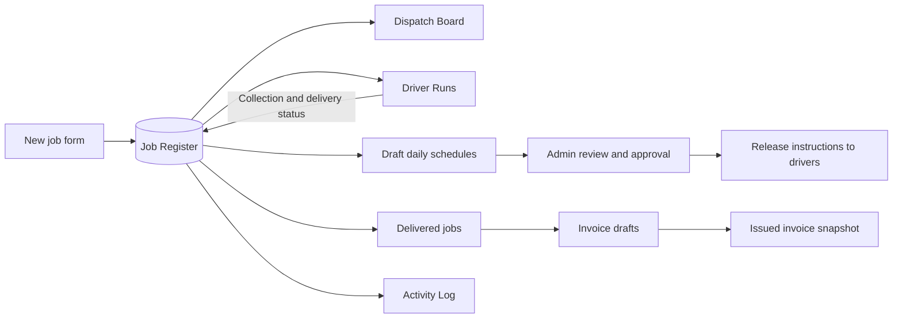

# TowEx data flow

## Rule: never create job records directly on the Dispatch Board

Dispatch is a **view** of the Job Register. The driver view is another projection over the same records. Status updates from either screen apply back to the shared job record. There is no manually maintained separate `dispatchJobs` table or workbook.

## Current persistence

`localStorage` persists a single-browser register only. For multi-user deployment replace `saveState` / `loadState` with authenticated backend operations. Client-side audit entries do not provide tamper-proof auditing.

## Proposed production relational schema

`jobs` has unique job UUID, idempotent external reference, version counter, client ID, VRM, vehicle, source/destination, schedule, driver ID, job status, collected/delivered timestamps, driver and billable miles, pricing choices, costs and invoice reference. `job_events` append-only job status/assignment history; `clients` and `drivers` are authoritative lookup entities; `invoices` and `invoice_items` snapshot issued prices. Index jobs on `(status, collection_date)`, `(driver_id, status)` and `(client_id, created_at)`.

Authenticated roles: owner/admin (write all), dispatcher (jobs & allocation), driver (read assigned / submit permitted status+evidence), accountant (invoice approvals only). Enforce authorization server-side. Never embed private keys in the frontend. Backups, restore and point-in-time recovery are needed before production.

## v0.3 daily planning and approval

`schedulePlans` in the register holds one set of dated driver stops, the dispatcher-entered compared route options, expected travel/handling times, shift start and planned maximum, relay notes, source signature and approval/release metadata. Release is prohibited if the job-register source changes or if route feasibility validation fails. A revised draft supersedes the earlier released plan (it cannot retract a WhatsApp message already sent).

**Future production:** daily multi-driver scheduling requires one shared cloud register and route matrix provider with real road options; drivers' starting locations, shifts and availability; collection/delivery windows, vehicle capacities, handover durations, inter-driver relays, pickup and rail/transit costs, traffic and customer priorities. Approval must be enforced by a server, not a client-provided `role` string. Publish immutable approved schedule versions with admin identity, driver acknowledgements, and revision notifications.
